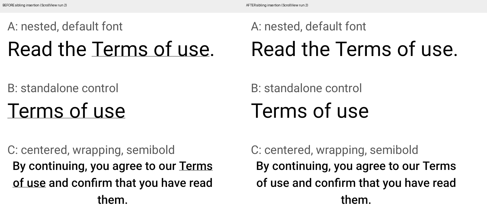
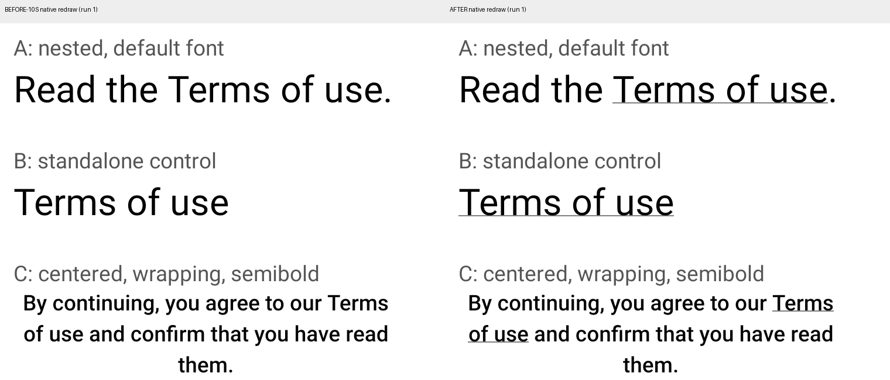

# Android measurements, 2026-10-20

All screenshots are lossless, full-size captures from this isolated app. No
accounts or private application screens were used. Each numbered run starts
with `am force-stop`, then `am start -W`; the final line of each `.txt` file is
the new process PID. See [device.txt](device.txt) and
[environment.txt](environment.txt) for the device and build environment.

The primary cold-launch series waits five seconds after `am start -W` returns.
The insertion series also captures that state, taps **INSERT SIBLINGS**, waits
two seconds and captures again. These are process restarts on one booted
emulator; neither app data nor the emulator is reset between runs. Images show
the settled state, not every frame during startup.

## Counts

Each cell counts runs, with the same outcome for A, B and C. A is nested
default-font text, B standalone default-font text, and C nested wrapping
semibold text. The ten insertion trials each start a new process.

| Series and observation | Underline present (each A/B/C) | Underline absent (each A/B/C) |
| --- | ---: | ---: |
| Fixed View, cold launch | 10/10 | 0/10 |
| Fixed View, further launches before insertion | 10/10 | 0/10 |
| Fixed View, after insertion | 10/10 | 0/10 |
| ScrollView, cold launch before insertion | 10/10 | 0/10 |
| ScrollView, after insertion | 6/10 | 4/10 |
| Native-redraw series, after insertion | 2/4 | 2/4 |
| Native-redraw series, further ten-second wait | 2/4 | 2/4 |
| Native-redraw series, after native redraw | 4/4 | 0/4 |

ScrollView failures are runs **2, 3, 7 and 9**. Runs 1, 4, 5, 6, 8 and 10
retain all three underlines. The first four runs include the opacity probe:
it restored A in **0/2 affected trials** (runs 2 and 3); runs 1 and 4 already
had underlines. B and C also remain absent in those two affected trials.
Run 1's additional ten-second capture remains underlined.

In the four additional native-redraw trials, runs **1 and 3** lose all three
underlines after insertion. They stay absent for a further ten seconds, then
all restore after the native redraw: **2/2 affected trials restored**. Runs 2
and 4 retain their underlines throughout. These four trials are separate from
the primary ten-run insertion count.

[results.csv](results.csv) records every measured screenshot's A/B/C outcome
and SHA-256. Counts were read from full-resolution crops; byte-identical text
regions were grouped to verify repeated outcomes. [SHA256SUMS](SHA256SUMS)
covers all PNGs, including preliminary images and the two comparison images.
Each comparison crops `(40,350)-(800,960)` from its corresponding full PNG,
without resampling or changing pixels, and adds labels above the crops.

| Insertion, ScrollView run 2 | Native redraw, run 1 |
| --- | --- |
|  |  |

Cold-launch-only underline loss was not observed in this minimal app. The
bounded ScrollView insertion condition reproduces the visible missing
decoration without changing the underlined text's contents or styles.

## Build identity and method

| Series | Source revision | Capture directory |
| --- | --- | --- |
| Fixed View, cold launch | `a4a2ee499dbab05297ce9326ca6dea28c72df437` | [cold](cold) |
| Fixed View, eight inserted siblings | same | [layout](layout) |
| ScrollView, eight inserted siblings | `e934a797ee95317de1bb99f564466e83994d0060` | [scroll](scroll) |
| ScrollView, native redraw probe | same | [native-redraw](native-redraw) |

The ScrollView revision changes only the outer container and moves the
background/flex styling to its viewport. The nested text, standalone control,
wrapping semibold text, insertion and dependency lock stay the same.

Original fixed-View APK SHA-256:
`62a0888ed83790bdc952ad0f7cb9116cd38bb904d3ac5ab7a520052f40854e4c`.
ScrollView APK SHA-256:
`2a325f626ad84330d57c5409af94ac2e64fc969f29a494828534a62be20bc2d2`.
Both were built as release variants with an embedded JS bundle, ARM64,
Hermes and the New Architecture. Build commands are in the root README.

The CLI environment command was
`npx --yes @react-native-community/cli@20.2.0 info`. Its Hermes/architecture
detection says "Not found" for the generated Expo project; the generated
`android/gradle.properties` explicitly enables both.

Both APK builds completed successfully. The fixed-View build took 5m38s;
the incremental ScrollView build took 3m15s. Neither modifies React Native's
native implementation. The final native-redraw trial's PID was 6053;
[runtime-errors.txt](runtime-errors.txt) contains only the buffer header, with
no matching error entries, from
`adb -s emulator-5570 logcat -d --pid=6053 -v brief ReactNativeJS:E AndroidRuntime:E '*:S'`.
This filtered snapshot does not cover previous processes.

For this 1080x2400, 420-dpi screen, the insertion command was
`adb -s "$ANDROID_SERIAL" shell input tap 540 1070`. Other devices should tap
the visible button instead. The fixed-View run 1 has an additional screenshot
taken after a further ten-second wait; all underlines remain visible there.

The emulator was slow during some launches. The raw launch logs preserve
`Status: timeout` where returned; each counted screenshot must still show the
fully rendered app. A launch log alone does not determine the underline count.
The emulator host also emitted `Failed to find ColorBuffer` warnings. The
graphics driver was not isolated, and no physical Android device or iOS run
was performed. These counts describe this emulator only.

Two interrupted ScrollView capture attempts were excluded in full after an
unrelated account-screen interaction and a system dialog obscured the app.
Those images are not published. The final ScrollView series was run after a
fresh emulator boot and reinstall of the same APK. Fixed-View captures were
completed before that interruption.

`initial.png` and [exploratory-scroll](exploratory-scroll) are preliminary
captures, separate from the numbered measurement series.

## What this tests

The fixed-View control and ScrollView variant differ only in their outer
container. A, B and C exercise nested/default, standalone/default and
nested/wrapping/semibold text respectively. No font library or application
dependency is needed for the ScrollView insertion failure.

The opacity button changes only A's alpha. That may reuse an Android display
list, so it is distinct from the native redraw probe. The native probe sets
`debug.layout=true`, sends `service call activity 1599295570`, then repeats
with `debug.layout=false`; screenshots are taken after debug bounds are off.
The service transaction results are retained alongside the launch logs.
`service call` prints `Parcel(Error: ... "Not a data message")` for this
transaction. We therefore record the visual recovery after the complete
property/notification sequence, without claiming a successful reply payload
or isolating which part of that sequence caused the redraw. The final
`getprop debug.layout` check returned `false` before the emulator was stopped.

The null-layout explanation remains unverified at runtime. In
[`ReactTextView.onDraw` at v0.88.0](https://github.com/react/react-native/blob/v0.88.0/packages/react-native/ReactAndroid/src/main/java/com/facebook/react/views/text/ReactTextView.java#L188),
the canvas-effect path requires a non-null `getLayout()`, while the null branch
calls `super.onDraw` alone. Android 11's
[`TextView.onDraw`](https://android.googlesource.com/platform/frameworks/base/+/refs/heads/android11-release/core/java/android/widget/TextView.java)
can rebuild a missing layout through `assumeLayout()`. This is compatible with
a skipped-decoration hypothesis, but this app does not instrument that branch
or prove it is the branch taken. No native code was modified.
